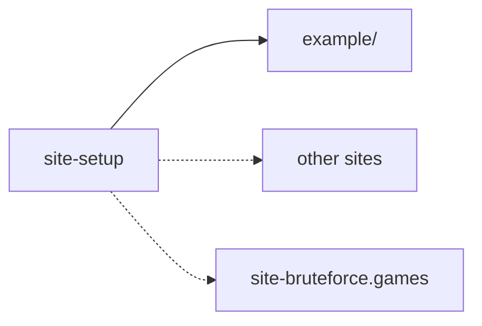

# bfg-starter

What every Brute Force Games static site shares, as one package a site depends on and extends:
**`@brute-force-games/site-setup`** (`packages/site-setup/`). A site keeps only what's its own
(its pages, its content, its theme's token values) and a few lines of config over the presets.
The plan: the repo migration plan, "The shared site setup".



## What's in it

| Entry                                        | What it gives a site                                                                                                                                                                                                                                                                                                                                                                                                                                                                        |
| -------------------------------------------- | ------------------------------------------------------------------------------------------------------------------------------------------------------------------------------------------------------------------------------------------------------------------------------------------------------------------------------------------------------------------------------------------------------------------------------------------------------------------------------------------- |
| `./astro`                                    | `siteAstroConfig({ root, site?, port, linked?, optimize? })`: static pages (at `site`, else `SITE_URL`, else its dev server) with React islands, its own dev port, and the Vite settings `file:`-linked bfg-core packages need                                                                                                                                                                                                                                                              |
| `./vitest`                                   | `siteVitestConfig({ coverageMinimums?, coverageInclude?, extraCoverageReporters?, unitProject?, exclusions? })`: the unit, integration and property stages, coverage in a fresh folder per run, held to the site's minimums (by glob; a site-wide one is Vitest's `"**"` key), counting `src/` unless `coverageInclude` says more, with reports beside text-summary, json-summary and html (Cobertura, say), the unit project named `unit` unless the site's is another (its `unitProject`) |
| `./tsconfig.json`                            | the TypeScript base a site's `tsconfig.json` extends                                                                                                                                                                                                                                                                                                                                                                                                                                        |
| `./playwright`                               | `sitePlaywrightConfig({ port, devices })` (`devices` the site's own, from its `@playwright/test`): e2e against the site's own dev server (never started for it; no run at all unless it's healthy, the gate running the smoke check and saying what's wrong), each run's output in a fresh folder                                                                                                                                                                                           |
| `./lint`                                     | the oxlint base a site's `.oxlintrc.json` extends (bfg-core's preset)                                                                                                                                                                                                                                                                                                                                                                                                                       |
| `./knip`                                     | `siteKnipConfig({ entry?, ignore?, ignoreDependencies?, ignoreBinaries?, root? })`, a site's `knip.ts`: every kind of dead code an error (a bare `knip` exits non-zero on any; unused exports and types ratchet down through `bfg-site dead-code`'s baseline), its content collections an entry if it has a `content/` folder, and programs its scripts run that no package provides (`mktemp`) in `ignoreBinaries`                                                                         |
| `./components/PageReadyStatus`               | the ready status of a page with no room: "Loading…" until every island has hydrated, then "Ready", in room-view's words (`useAllIslandsHydrated` is `./components/useAllIslandsHydrated`)                                                                                                                                                                                                                                                                                                   |
| `./e2e`                                      | `open(page, url)` (goes to a page and waits for its "Ready"), `pageReady(page)`, `islandHydrated(locator)`, `readyStatus(page)`: Playwright's types only                                                                                                                                                                                                                                                                                                                                    |
| `./e2e-guard`                                | `directGotos(dir)`: each `.goto(` a site's e2e tests make themselves, for a unit test that keeps every page opened through `open`                                                                                                                                                                                                                                                                                                                                                           |
| `./oxfmt`                                    | `siteOxfmtConfig({ ignore? })`, a site's `oxfmt.config.ts` (oxfmt has no `extends`): authored prose, lock files and tool output left alone                                                                                                                                                                                                                                                                                                                                                  |
| `./content`                                  | `markdownIn(folder)`, `yamlIn(folder)`: a content collection's loader, over content/`folder`                                                                                                                                                                                                                                                                                                                                                                                                |
| `./storybook`                                | `siteStorybookConfig({ root, linked? })`, a site's `.storybook/main.ts`: React on Vite, its own stories, no telemetry, its links served as in its Astro config                                                                                                                                                                                                                                                                                                                              |
| `./storybook/preview`                        | `sitePreview`, a site's `.storybook/preview.tsx`: the theme toolbar (system, light, dark)                                                                                                                                                                                                                                                                                                                                                                                                   |
| `./integrations/storybook`                   | `storybookRoute({ root, includeInBuild })`: Storybook at /storybook/, a snapshot rebuilt in the background in dev, and in the built site unless left out                                                                                                                                                                                                                                                                                                                                    |
| `./integrations/stale-code`                  | `staleCodeWarning()`: in dev, every tab told which file changed (`bfg:code-changed`), for code hot reload can't refresh                                                                                                                                                                                                                                                                                                                                                                     |
| `./integrations/page-search`                 | `pageSearch({ glob })`: Pagefind's static search index over the built pages `glob` picks                                                                                                                                                                                                                                                                                                                                                                                                    |
| `./lint/complexity`                          | the complexity report's oxlint base (each function's cyclomatic and cognitive complexity over 10) a site's `.oxlintrc.complexity.json` extends                                                                                                                                                                                                                                                                                                                                              |
| `./reports/runs`, `./reports/folder`         | each run's HTML reports: a folder of its own, `reports/<date-time>-<commit>/`, the newest `REPORTS_KEEP` (5) kept; the Vitest and Playwright presets add their HTML reports there when a run sets `BFG_TEST_REPORT_DIR` and `BFG_REPORT_DIR`                                                                                                                                                                                                                                                |
| `./reports/complexity`                       | the complexity report: oxlint's SARIF, rendered to HTML by sarif-explorer                                                                                                                                                                                                                                                                                                                                                                                                                   |
| `./dev-server-caches`                        | `devServerCachesFrom(env)`: the caches of a dev server of verify's own (`BFG_DEV_SERVER_CACHE`), for a site's Astro config not yet on the preset                                                                                                                                                                                                                                                                                                                                            |
| `./coverage-minimum`                         | `readCoverageMinimums(path)` and the ratchet's schema: a site's Vitest config reads its `coverage-minimum.json` through it                                                                                                                                                                                                                                                                                                                                                                  |
| `./styles/tokens.css`, `./styles/global.css` | the design tokens (a site overrides values, never names) and the body rule                                                                                                                                                                                                                                                                                                                                                                                                                  |
| `./layouts/BaseLayout.astro`                 | the page shell: head, title, description, a nav, and slots for the head and the page; its header ends with the page's ready status (`status` slot, `PageReadyStatus` unless the page fills it)                                                                                                                                                                                                                                                                                              |

### The `bfg-site` command

The scripts a site runs, in its folder (`npx bfg-site <command>`):

- `smoke`: whether the dev server in play is healthy, page by page (below). Run it alone before
  any heavy run against your dev server; it never starts or restarts one.
- `verify`: the smoke check first, then the test stages, cheapest first (smoke, static, unit,
  integration, property, e2e). A red smoke check stops the run at once; with no dev server up it's
  skipped (and so is e2e). Each check's output goes to a fresh folder, and the run's reports to
  `reports/<date-time>-<commit>/`. e2e runs only once the stages below it are green and your dev
  server answers. `--build` runs every stage but smoke and e2e and stops at the first red one;
  `--stage <name>` runs one stage; `--own-dev-server` runs smoke and e2e each on a dev server
  verify starts on a free port and stops afterwards (its caches stay in the run's folder).
- `coverage [--record] [--reports=<run folder>] [vitest arguments]`: the unit tests with coverage,
  in a folder of their own. A green run of the whole suite raises
  `<qualityFolder>/coverage-minimum.json`, if the site keeps one.
- `quality`: `coverage`, with the run recorded in `<qualityFolder>/history.json` (coverage
  totals, complexity findings, dead code by kind, unreachable code).
- `dead-code`: knip's findings, every kind held at zero but unused exports and types, which may
  not rise above `<qualityFolder>/dead-code-baseline.json`, and lower it when they fall.
- `complexity <run folder>`: the complexity report, into a run's folder.
- `fresh-build <target> -- <command, one argument with {out}>`: the build in a fresh folder under
  `.builds/`, swapped in for `<target>` only when it succeeds.
- `check-node`: `.nvmrc`, devbox.json's `nodejs@<major>` and package.json's `engines.node`,
  whichever the site has, must agree with each other and with the running Node.
- `audit <record.cbor> [--json]`: a game record (`bfg/game-record/…`, a room's exported copy)
  audited offline with the site's own games, as bfg-core's `bfg-audit` does (decision 0033): 0
  clean, 1 findings, 2 a file that can't be trusted, 64 asked wrongly or a games module it can't
  use.
- `check-proof <proof.cbor> [--json]`: a cheat proof (`bfg/cheat-proof/1`) checked the same way,
  as `bfg-verify` does: 0 it convicts, 1 it doesn't.

### The scripts a site starts with

Every site starts with these in its package.json, as the example has them (a test holds the
example to this list):

| Script                   | Runs                                        | When                                                                                                                                                                                                             |
| ------------------------ | ------------------------------------------- | ---------------------------------------------------------------------------------------------------------------------------------------------------------------------------------------------------------------- |
| `dev`                    | `astro dev`                                 | while you work                                                                                                                                                                                                   |
| `check:watch`            | `astro check --watch`                       | beside `dev`, in a second terminal: the dev server doesn't type-check `.astro` files and `tsc` can't read them, so this catches what `astro check` would (a page passing its layout the wrong props) as you save |
| `build`                  | `astro build`                               | to build the site                                                                                                                                                                                                |
| `typecheck`              | `astro sync && astro check && tsc --noEmit` | once, before you're done                                                                                                                                                                                         |
| `test`                   | `vitest run --project unit`                 | the unit tests                                                                                                                                                                                                   |
| `test:e2e`               | `playwright test`                           | the end-to-end tests, against your dev server                                                                                                                                                                    |
| `smoke`                  | `bfg-site smoke`                            | before any heavy run: is your dev server healthy?                                                                                                                                                                |
| `lint`                   | `oxlint --type-aware && knip`               | lint and dead code                                                                                                                                                                                               |
| `format`, `format:check` | `oxfmt [--check] --ignore-path .gitignore`  | formatting                                                                                                                                                                                                       |
| `verify`                 | `bfg-site verify`                           | every stage, smoke first                                                                                                                                                                                         |

A site using Storybook adds `storybook`.

### `bfg-site.json`

At the site's root. `devServerPort` is required: where verify looks for your dev server, unless
`E2E_BASE_URL` says otherwise. The rest have defaults: `qualityFolder` (`"docs/quality"`),
`sources` (`["src", "scripts"]`, for the complexity and unreachable-code counts), `unitProject`
(`"unit"`, the Vitest project coverage counts), `formatIgnoreFiles` (`[".gitignore"]`, each given to
the format check as `--ignore-path`), `staticChecks` (the site's own checks,
`{ "name", "program", "args" }`, run beside the shared static ones), `smokePages` (`[]`, pages the
smoke check opens beside the routes it finds: at least one for each route with parameters, such as
`"/rooms/demo"` for `/rooms/[id]`), `smokeSkip` (`[]`, routes or patterns it leaves out) and `games` (none: a module, from the
site's root, exporting `games: GameLookup`, for `audit` and `check-proof`; without it they use the
reference games only). Both commands run bfg-core's audit-cli in a process of its own under tsx
(site-setup's own, so a site needn't have it), in the site's root, so the games module may import
through the site's tsconfig path aliases.

A site's config is then a few lines:

```ts
// astro.config.ts
import { siteAstroConfig } from "@brute-force-games/site-setup/astro";
export default siteAstroConfig({
  root: import.meta.dirname,
  site: "https://bruteforce.games",
  port: 4322,
});
```

### The ready status

Every page says, in its header, whether it's ready to use: "Loading…" until it can be, then
"Ready" (bfg-core's
[docs/design-notes/ready-status.md](../bfg-core/docs/design-notes/ready-status.md)). BaseLayout's
`status` slot shows `PageReadyStatus`, ready once every island on the page has hydrated; a room's
page puts the room's own `ReadyStatus` (room-ui) there instead. Both are one `role="status"` named
`READY_STATUS_NAME`, in room-view's words.

End-to-end tests start every page from it: they open pages through `open(page, url)` (`./e2e`),
which waits for "Ready", never with `page.goto`, and a site's unit test asserts
`directGotos("tests/e2e")` (`./e2e-guard`) is empty. `pageReady(page)` waits again after a page
changes in place (a new room); `islandHydrated(locator)` waits for one island.

The components import room-view's dependency-free `./readiness` entry and React only, and the
Astro preset pre-bundles what they import (`SETUP_RUNTIME`, held to their imports by a test), so a
site's first visit never re-optimizes and reloads the page.

### The smoke check

Is the dev server healthy, before anything heavy runs against it? A stale one fails every page in
ways a base-URL fetch can't see: a 500 on each game page, or every island failing to hydrate
("_jsxDEV is not a function") after another run re-optimized its dependencies under it.

For every page route in `src/pages` (endpoints and `_`-prefixed files left out, routes with
parameters through `smokePages`), it asks for the page and wants a 200, then opens it in headless
Chromium and wants no uncaught error, no response of 500 or more while it loads (Vite answers 504
for a dependency it re-optimized), and the page's status reading "Ready" within 15 seconds. It
reports each failing page with the first thing wrong, and a route with parameters that has no page
in `smokePages` is red too, never silently skipped. Astro's own error pages at the root are checked at
their own status, not skipped: `404.astro` at a path no site has (it must answer 404), and
`500.astro` at `/500` (500); either still has to open without an error and read Ready.

It runs in three places, always against the dev server in play and never one of its own: `npx
bfg-site smoke` (yours, at `E2E_BASE_URL` or the site's port), verify's first stage (yours, or
verify's own with `--own-dev-server`), and the e2e gate, Playwright's global setup, before any
test. Chromium comes from the site's own `@playwright/test`, loaded from its install at run time,
so a site needs its browsers installed (`npx playwright install chromium`). When it's red, restart
the dev server and run it again.

### Linking with `file:`

A site links the setup by `file:`, so the presets' runtime imports (Astro's React integration,
`astro/config`, the bin's tools) resolve from bfg-starter's `node_modules`, not the site's: a site
keeps the same pins as bfg-starter. Anything a runner checks for identity comes from the site
instead: the Playwright preset imports Playwright's types only, and the site passes its own
`devices` (Playwright refuses a second copy of itself). A test holds the preset to that.

## Its rules

- **Its tools are peer dependencies:** a site installs Astro, React, Vitest, Playwright, oxlint,
  knip and oxfmt (and Storybook and Pagefind if it uses them) and pins them; the setup says which
  ranges it supports. A site with React islands tests them with Testing Library, two optional
  peers: `@testing-library/react` (render, and find by role and name) and
  `@testing-library/user-event` (act as a person does, never `fireEvent` by hand), with the site's
  own `@testing-library/jest-dom` matchers; the example's `tests/unit/Counter.test.tsx` shows
  them. `@vitest/ui` and `sarif-explorer` are run by verify's reports, never imported; knip
  counts them as site-setup's peers, so a site needn't ignore them.
- **The config entries load in plain Node, before any bundler:** they import only their peer
  tools, `node:` and relative files (with explicit `.ts`), never a workspace package.
- **Its presets are tested at 100%** (`npm run test:coverage`); `example/` is a site on all of
  them, checked by its type check, its build and its tests.
- **Nothing of any one site's.**

## Commands

- `npm run test:coverage`: the setup's own tests, held to 100%, in two Vitest projects: `unit`,
  and `browser` (the e2e helpers and the smoke check in headless Chromium, the smoke check against
  a tiny server of the test's own, one file at a time).
- `npm run typecheck`: the setup, and the example site (`astro check` and `tsc`).
- `npm run lint`: the setup's oxlint (its own preset, `.oxlintrc.json`) and knip (`knip.ts`); the
  example lints itself (`npm run example:lint`).
- `npm run format`, `npm run format:check`: the setup formatted as every site is, by its own
  `siteOxfmtConfig` (`oxfmt.config.ts`).
- `npm run example:test`, `npm run example:build`: the example site's tests and build.
- `npm run example:lint`: the example's oxlint, then knip.
- `npm run example:e2e`: the example's end-to-end tests, against its dev server, which you start.
- `npm -w example run verify`: the example's `bfg-site verify`, every stage.

The old app (a TanStack Router demo of local-first multiplayer) is in git history, at `b35dee9`;
its game modules (`modules/`, submodules) are left as they were, to be archived.
