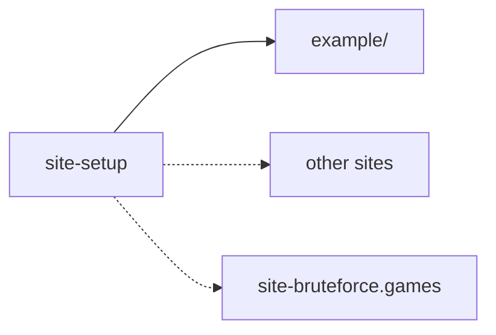

# bfg-starter

What every Brute Force Games static site shares, as one package a site depends on and extends:
**`@brute-force-games/site-setup`** (`packages/site-setup/`). A site keeps only what's its own
(its pages, its content, its theme's token values) and a few lines of config over the presets.
The plan: the repo migration plan, "The shared site setup".



## What's in it so far

| Entry | What it gives a site |
| --- | --- |
| `./astro` | `siteAstroConfig({ root, site?, port, linked?, optimize? })`: static pages (at `site`, else `SITE_URL`, else its dev server) with React islands, its own dev port, and the Vite settings `file:`-linked bfg-core packages need |
| `./vitest` | `siteVitestConfig(options)`: the unit, integration and property stages, coverage in a fresh folder per run, held to the site's minimums |
| `./tsconfig.json` | the TypeScript base a site's `tsconfig.json` extends |
| `./playwright` | `sitePlaywrightConfig({ port })`: e2e against the site's own dev server (never started for it; no run at all without it, the gate saying how to start it), each run's output in a fresh folder |
| `./lint` | the oxlint base a site's `.oxlintrc.json` extends (bfg-core's preset) |
| `./knip` | `siteKnipConfig({ entry?, ignore?, ignoreDependencies? })`, a site's `knip.ts`: every kind of dead code held at zero, its content collections an entry |
| `./oxfmt` | `siteOxfmtConfig({ ignore? })`, a site's `oxfmt.config.ts` (oxfmt has no `extends`): authored prose, lock files and tool output left alone |
| `./content` | `markdownIn(folder)`, `yamlIn(folder)`: a content collection's loader, over content/`folder` |
| `./storybook` | `siteStorybookConfig({ root, linked? })`, a site's `.storybook/main.ts`: React on Vite, its own stories, no telemetry, its links served as in its Astro config |
| `./storybook/preview` | `sitePreview`, a site's `.storybook/preview.tsx`: the theme toolbar (system, light, dark) |
| `./integrations/storybook` | `storybookRoute({ root, includeInBuild })`: Storybook at /storybook/, a snapshot rebuilt in the background in dev, and in the built site unless left out |
| `./integrations/stale-code` | `staleCodeWarning()`: in dev, every tab told which file changed (`bfg:code-changed`), for code hot reload can't refresh |
| `./integrations/page-search` | `pageSearch({ glob })`: Pagefind's static search index over the built pages `glob` picks |
| `./lint/complexity` | the complexity report's oxlint base (each function's cyclomatic and cognitive complexity over 10) a site's `.oxlintrc.complexity.json` extends |
| `./reports/runs`, `./reports/folder` | each run's HTML reports: a folder of its own, `reports/<date-time>-<commit>/`, the newest `REPORTS_KEEP` (5) kept; the Vitest and Playwright presets add their HTML reports there when a run sets `BFG_TEST_REPORT_DIR` and `BFG_REPORT_DIR` |
| `./reports/complexity` | the complexity report: oxlint's SARIF, rendered to HTML by sarif-explorer |
| `./styles/tokens.css`, `./styles/global.css` | the design tokens (a site overrides values, never names) and the body rule |
| `./layouts/BaseLayout.astro` | the page shell: head, title, description, a nav, and slots for the head and the page |

### The `bfg-site` command

The scripts a site runs, in its folder (`npx bfg-site <command>`):

- `verify`: the test stages, cheapest first (static, unit, integration, property, e2e). Each
  check's output goes to a fresh folder, and the run's reports to `reports/<date-time>-<commit>/`.
  e2e runs only once the stages below it are green and your dev server answers. `--build` runs
  every stage but e2e and stops at the first red one; `--stage <name>` runs one stage;
  `--own-dev-server` runs e2e on a dev server verify starts on a free port and stops afterwards
  (its caches stay in the run's folder).
- `coverage [--record] [--reports=<run folder>] [vitest arguments]`: the unit tests with coverage,
  in a folder of their own. A green run of the whole suite raises
  `<qualityFolder>/coverage-minimum.json`, if the site keeps one.
- `quality`: `coverage`, with the run recorded in `<qualityFolder>/history.json` (coverage
  totals, complexity findings, dead code by kind, unreachable code).
- `dead-code`: knip's findings, every kind held at zero but unused exports and types, which may
  not rise above `<qualityFolder>/dead-code-baseline.json`, and lower it when they fall.
- `complexity <run folder>`: the complexity report, into a run's folder.
- `fresh-build <target> -- <command, one argument with {out}>`: the build in a fresh folder under
  `.builds/`, swapped in for `<target>` only when it succeeds.
- `check-node`: `.nvmrc`, devbox.json's `nodejs@<major>` and package.json's `engines.node`,
  whichever the site has, must agree with each other and with the running Node.

### `bfg-site.json`

At the site's root. `devServerPort` is required: where verify looks for your dev server, unless
`E2E_BASE_URL` says otherwise. The rest have defaults: `qualityFolder` (`"docs/quality"`),
`sources` (`["src", "scripts"]`, for the complexity and unreachable-code counts), and
`staticChecks` (the site's own checks, `{ "name", "program", "args" }`, run beside the shared
static ones).

A site's config is then a few lines:

```ts
// astro.config.ts
import { siteAstroConfig } from "@brute-force-games/site-setup/astro";
export default siteAstroConfig({ root: import.meta.dirname, site: "https://bruteforce.games", port: 4322 });
```

## Its rules

- **Its tools are peer dependencies:** a site installs Astro, React, Vitest, Playwright, oxlint,
  knip and oxfmt (and Storybook and Pagefind if it uses them) and pins them; the setup says which
  ranges it supports.
- **The config entries load in plain Node, before any bundler:** they import only their peer
  tools, `node:` and relative files (with explicit `.ts`), never a workspace package.
- **Its presets are tested at 100%** (`npm run test:coverage`); `example/` is a site on all of
  them, checked by its type check, its build and its tests.
- **Nothing of any one site's.**

## Commands

- `npm run test:coverage`: the setup's own tests, held to 100%.
- `npm run typecheck`: the setup, and the example site (`astro check` and `tsc`).
- `npm run example:test`, `npm run example:build`: the example site's tests and build.

The old app (a TanStack Router demo of local-first multiplayer) is in git history, at `b35dee9`;
its game modules (`modules/`, submodules) are left as they were, to be archived.
